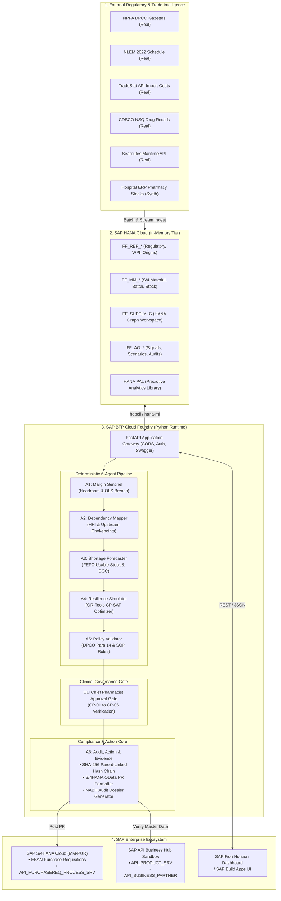
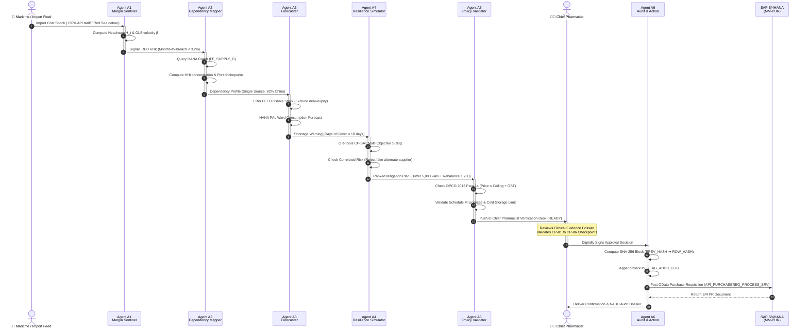

# Kairos: Early-Warning Pharmaceutical Supply Chain Resilience
<p align="center">
  
</p>

**SAP Hackfest 2026 · Kairos · Track: Resilient Supply Chains**

Kairos flags price-controlled essential medicines whose production economics are quietly breaking **before** a shortage appears on hospital shelves. Built on **SAP HANA Cloud**, **SAP BTP**, and **SAP S/4HANA** architectures, it orchestrates a six-agent autonomous pipeline with a strict **Chief Pharmacist Human Approval Gate**.

---

## Table of Contents
1. [The Core Problem](#1-the-core-problem)
2. [High Level Design (HLD)](#2-high-level-design-hld)
3. [Low Level Design (LLD)](#3-low-level-design-lld)
4. [End-to-End Operational Workflow](#4-end-to-end-operational-workflow)
5. [Web Page & UI/UX Design](#5-web-page--uiux-design)
6. [The 6-Agent Pipeline & Human Gate](#6-the-6-agent-pipeline--human-gate)
7. [SAP Integrations & Architecture Compliance](#7-sap-integrations--architecture-compliance)
8. [Historical Proof: The Para-19 Backtest](#8-historical-proof-the-para-19-backtest)
9. [Quick Start & Running Locally](#9-quick-start--running-locally)
10. [Repository Structure](#10-repository-structure)
11. [Governance & Contributing](#11-governance--contributing)

---

## 1. The Core Problem

Under India's **Drug Price Control Order (DPCO 2013)** administered by the **National Pharmaceutical Pricing Authority (NPPA)**, ceiling prices for essential formulations (NLEM 2022) are fixed by statutory gazette notification.

When upstream **Active Pharmaceutical Ingredient (API)** import costs, maritime freight rates, or energy tariffs surge:
1. **Margin Squeeze:** Manufacturers cannot pass on cost increases due to statutory price caps.
2. **Economic Exhaustion:** Margin headroom turns negative, rendering production commercially unviable.
3. **Silent Discontinuation:** Manufacturers quietly scale down production months before filing formal statutory notices with the government.
4. **Sudden Hospital Stockouts:** Hospitals, intensive care units, and patients suddenly face critical shortages of life-saving antibiotics, anesthetics, and injectables.

> *"The first sign of a drug shortage is not an empty pharmacy shelf. It is the manufacturing cost rising towards a ceiling the producer is legally forbidden to raise."*

---

## 2. High Level Design (HLD)

The High Level Design outlines the multi-tier enterprise architecture of Kairos, bridging external regulatory intelligence, SAP in-memory databases, an autonomous agentic reasoning pipeline, human clinical governance, and enterprise ERP transaction posting.

### 2.1 System Architecture Diagram



### 2.2 Component Roles & Responsibilities

| Tier / Component | Technology Stack | Core Responsibility |
|---|---|---|
| **External Intelligence** | Python, `pdfplumber`, `requests` | Ingests official NPPA price notifications, Ministry of Commerce TradeStat import records, CDSCO recall circulars, and live Searoutes maritime port tracking. |
| **In-Memory Store** | **SAP HANA Cloud** | Column-store tables (`FF_REF_*`, `FF_MM_*`), native **HANA Graph Workspace** (`FF_SUPPLY_G`) for multi-tier chemical BOM traversal, and **HANA PAL** for ward demand forecasting. |
| **Backend API Gateway** | **FastAPI**, Pydantic v2, Python 3.11+ | High-performance asynchronous API layer hosted on **SAP BTP Cloud Foundry**, enforcing API key security (`X-API-Key`), CORS policies, and transaction coordination. |
| **Agent Reasoning Core** | Pure functional Python, OR-Tools, NetworkX | Deterministic mathematical evaluation without hallucination: margin slope calculation, supplier concentration metrics, linear programming scenario optimization, and rule checks. |
| **Clinical Governance** | Interactive Web UI / SAP Build Apps | Human-in-the-Loop decision checkpoint where the Chief Pharmacist inspects recommendations, verifies clinical safety checkpoints, and signs off. |
| **Audit & Enterprise Action** | Hash-chained cryptography, S/4HANA OData | Writes immutable SHA-256 tamper-evident logs, triggers purchase requisitions into SAP S/4HANA `EBAN`, and exports NABH hospital audit documentation. |

---

## 3. Low Level Design (LLD)

The Low Level Design details the schema architecture, mathematical equations, algorithm formulations, cryptographic security, and REST interface contracts.

### 3.1 Database Schema Design (SAP HANA Cloud DDL)

The data model maintains strict parity with **SAP S/4HANA Materials Management (MM)** structures:

```
┌────────────────────────────────────────────────────────────────────────────────────────┐
│                                 SAP HANA CLOUD TABLES                                  │
├─────────────────────────┬─────────────────────────┬────────────────────────────────────┤
│ Table Name              │ Corresponds to S/4HANA  │ Primary Description                │
├─────────────────────────┼─────────────────────────┼────────────────────────────────────┤
│ FF_REF_CEILING          │ Custom / Legal Reference│ NPPA DPCO price ceiling gazettes   │
│ FF_REF_ORIGIN           │ Custom / TradeStat Data │ API chemical import costs & ports  │
│ FF_REF_WPI              │ Custom / Economic Index │ Wholesale Price Index monthly trend│
│ FF_MM_MARA              │ MARA (General Material) │ Hospital material master records   │
│ FF_MM_MCHB              │ MCHB (Batch Stock)      │ Batch numbers, inventory & expiry  │
│ FF_MM_MSEG              │ MSEG (Material Document)│ Historical ward consumption ledger │
│ FF_MM_EBAN              │ EBAN (Purchase Req.)    │ Generated S/4 purchase requisitions│
│ FF_MM_LFA1              │ LFA1 (Vendor Master)    │ Drug licence numbers & GMP ratings │
│ FF_AG_SIGNALS           │ Agent Working State     │ Real-time margin headroom & risks  │
│ FF_AG_SCENARIOS         │ Agent Working State     │ OR-Tools optimized mitigation runs │
│ FF_AG_AUDIT_LOG         │ Immutable Audit Ledger  │ SHA-256 parent-linked audit blocks │
└─────────────────────────┴─────────────────────────┴────────────────────────────────────┘
```

#### Key Schema Excerpt: Tamper-Evident Audit Ledger (`FF_AG_AUDIT_LOG`)
```sql
CREATE COLUMN TABLE FF_AG_AUDIT_LOG (
    EVENT_ID      NVARCHAR(64)  NOT NULL PRIMARY KEY,
    TIMESTAMP     NVARCHAR(32)  NOT NULL,
    AGENT_ID      NVARCHAR(16)  NOT NULL,  -- A1, A2, A3, A4, A5, HUMAN, A6
    EVENT_TYPE    NVARCHAR(32)  NOT NULL,  -- SIGNAL_DETECTED, SCENARIO_SIZED, APPROVED, PR_POSTED
    FORM_ID       NVARCHAR(64),
    ACTOR         NVARCHAR(128) NOT NULL,  -- System or authenticated user ID
    PREV_HASH     NVARCHAR(64)  NOT NULL,  -- SHA-256 of preceding row
    ROW_HASH      NVARCHAR(64)  NOT NULL,  -- SHA-256(PREV_HASH + TIMESTAMP + AGENT + ACTOR + PAYLOAD)
    PAYLOAD_JSON  NCLOB
);
```

---

### 3.2 Mathematical Formulations & Agent Algorithms

```
  ┌────────────────────────────────────────────────────────────────────────────────────────┐
  │                               ALGORITHMIC ARCHITECTURE                                 │
  │                                                                                        │
  │    A1: Margin Headroom        A2: Dependency HHI          A3: FEFO Usable Stock        │
  │   ┌─────────────────────┐    ┌─────────────────────┐    ┌─────────────────────────┐    │
  │   │   P_ceiling - C_t   │    │      N              │    │   DOC = Σ Usable Stock   │    │
  │   │ H = ─────────────── │    │ HHI = Σ s_i^2       │    │         ─────────────── │    │
  │   │      P_ceiling      │    │     i=1             │    │          Avg Daily Need │    │
  │   └─────────────────────┘    └─────────────────────┘    └─────────────────────────┘    │
  │              │                          │                            │                 │
  │              └──────────────────────────┼────────────────────────────┘                 │
  │                                         ▼                                              │
  │                         A4: OR-Tools Optimization Formulation                          │
  │   ┌────────────────────────────────────────────────────────────────────────────────┐   │
  │   │  min Cost = ProcureCost + λ_1(LeadTime) + λ_2(CorrelatedOriginRisk(Alt, Prim)) │   │
  │   │  s.t.  TotalBuffer ≥ RequiredShortageUnits                                     │   │
  │   │        ProcurePrice ≤ CeilingPrice × (1 + GST)   [A5 Policy Enforced]          │   │
  │   └────────────────────────────────────────────────────────────────────────────────┘   │
  └────────────────────────────────────────────────────────────────────────────────────────┘
```

#### 1. Agent A1: Margin Headroom & Velocity Model
Evaluates manufacturer margin headroom $H_t$ over time:
$$H_t = \frac{P_{\text{ceiling}} - C_t}{P_{\text{ceiling}}}$$
Where $P_{\text{ceiling}}$ is the DPCO notified ceiling and $C_t$ is the estimated unit production cost derived from landed TradeStat import pricing, packaging, and conversion index.

The rate of erosion is calculated via Ordinary Least Squares (OLS) linear regression over a rolling 6-month window:
$$\beta = \frac{\sum_{t=1}^T (t - \bar{t})(H_t - \bar{H})}{\sum_{t=1}^T (t - \bar{t})^2}$$
- When $\beta < 0$, **Months to Breach (MTB)** is projected as:
  $$MTB = \frac{H_{\text{current}}}{|\beta|}$$
- If $H_{\text{current}} < 0.15$ or $MTB \le 3$, Agent A1 elevates signal status to `RED`.

#### 2. Agent A2: Graph Supply Topology & Concentration
Traverses the multi-tier directed graph in **SAP HANA Graph Workspace** (`FF_SUPPLY_G`):
$$\text{Node Chain: } \text{KSM} \longrightarrow \text{API Molecule} \longrightarrow \text{Origin Country} \longrightarrow \text{Producer} \longrightarrow \text{Formulation} \longrightarrow \text{Hospital Warehouse}$$

Computes the **Herfindahl-Hirschman Index (HHI)** for producer and country market concentration:
$$HHI = \sum_{i=1}^N \left(\frac{q_i}{Q}\right)^2, \quad \text{where } Q = \sum_{i=1}^N q_i$$
- $HHI > 0.35$ or Origin share $> 75\%$ triggers a `HIGH_CONCENTRATION` risk warning.

#### 3. Agent A3: FEFO Usable Inventory & Days of Cover
Hospitals cannot treat expired stock as real safety inventory. Agent A3 applies **First-Expired, First-Out (FEFO)** filtering:
$$\text{Stock}_{\text{usable}} = \sum_{b \in \text{Batches}} \text{Quantity}_b \cdot \mathbb{I}(\text{ExpiryDate}_b - t_{\text{now}} > \text{Threshold}_{\text{quarantine}})$$
$$\text{Days of Cover (DOC)} = \frac{\text{Stock}_{\text{usable}}}{\text{Mean Daily Ward Demand}}$$
Exit probability is calculated through an empirical logistic sigmoid combining Headroom Risk, HHI, and DOC.

#### 4. Agent A4: OR-Tools CP-SAT Mixed-Integer Linear Program (MILP)
Sizes the optimal mitigation portfolio across three levers:
1. **Buffer Stock:** Expedited safety buffer ordering ($q_{\text{buf}}$).
2. **Alternate Manufacturer:** Sourcing from qualified secondary producers ($q_{\text{alt}}$).
3. **Inter-Hospital Rebalance:** Redistribution across sister depots ($q_{\text{trans}}$).

**The Correlated Risk Check (Preventing Fake Fixes):**
Standard hospital ERP systems frequently switch to an alternate supplier that secretly buys API from the exact same foreign plant or maritime corridor experiencing disruption. Kairos computes the origin correlation penalty:
$$\mathcal{P}_{\text{correlated}} = \text{Overlap}(\text{Origin}_{\text{alt}}, \text{Origin}_{\text{primary}}) \times \text{Weight}_{\text{chokepoint}}$$
The objective function minimizes total procurement and disruption impact:
$$\min \mathcal{J} = \sum c_{\text{unit}} \cdot q_k + \lambda_{\text{lead}} \cdot \text{LeadTime}_k + \lambda_{\text{corr}} \cdot \mathcal{P}_{\text{correlated}}$$

#### 5. Agent A5: Statutory Policy Verification
Enforces legal and hospital standard operating procedures (SOP):
- **DPCO 2013 Para 14 Price Cap:**
  $$P_{\text{proposed}} \le P_{\text{ceiling}} \times (1 + \text{GST}_{\text{rate}})$$
- **Schedule M Licencing:** Validates Form 20B/21B manufacturing licences in `FF_MM_LFA1`.
- **Cold-Chain Capacity:** Rejects buffer volumes exceeding verified 2°C–8°C refrigerated storage capacity.

#### 6. Agent A6: Cryptographic Hash Chain & Action Engine
Maintains an immutable append-only ledger where each block $i$ incorporates the SHA-256 hash of block $i-1$:
$$\text{ROW\_HASH}_i = \text{SHA-256}(\text{PREV\_HASH}_{i-1} \mathbin{\Vert} \text{TIMESTAMP}_i \mathbin{\Vert} \text{AGENT\_ID}_i \mathbin{\Vert} \text{ACTOR}_i \mathbin{\Vert} \text{PAYLOAD\_JSON}_i)$$
When human approval is certified, Agent A6 formats an S/4HANA OData v2/v4 Purchase Requisition payload:
```json
{
  "PurchaseRequisition": "",
  "PurchaseRequisitionItem": "00010",
  "Material": "BENZYL-PEN-10L",
  "Plant": "1000",
  "StorageLocation": "PH01",
  "RequestedQuantity": "5000",
  "BaseUnit": "VIAL",
  "PurchasingGroup": "001",
  "FixedVendor": "VEND_AUROBINDO",
  "DeliveryDate": "2026-10-15"
}
```

---

### 3.3 REST API Endpoints Specification

| Method | Endpoint | Description | Auth Required |
|---|---|---|---|
| `GET` | `/health` | Health probe reporting application state and active DB backend (`hana`/`sqlite`). | No |
| `GET` | `/watchlist` | Returns monitored essential formulations with current headroom and risk tiers. | Optional |
| `GET` | `/molecule/{id}` | Deep dive for a specific molecule (BOM, upstream suppliers, TradeStat pricing). | Optional |
| `POST` | `/disruptions/simulate` | Triggers on-demand cost shocks (e.g. +30% API import price surge). | Yes (`X-API-Key`) |
| `GET` | `/inventory` | Multi-depot pharmacy stock levels, FEFO expiry dates, and ward consumption. | Yes (`X-API-Key`) |
| `POST` | `/approval/submit` | Submits Chief Pharmacist approval decision with clinical checklist CP-01 to CP-06. | Yes (`X-API-Key`) |
| `GET` | `/audit/ledger` | Reads verified cryptographic SHA-256 audit blocks for compliance verification. | Yes (`X-API-Key`) |
| `GET` | `/audit/report/{id}` | Generates printable NABH evidence compliance audit report HTML. | Optional |
| `GET` | `/nsq/trace` | CDSCO Not of Standard Quality batch recall tracing across all hospital wards. | Optional |

---

## 4. End-to-End Operational Workflow

The following sequence details how Kairos detects an emerging risk, sizes an optimal mitigation strategy, enforces the human clinical approval gate, and commits transactions to SAP S/4HANA:



---

## 5. Web Page & UI/UX Design

The user interface of Kairos is implemented as an enterprise-grade responsive web dashboard adhering strictly to **SAP Fiori Horizon** design principles.

### 5.1 Design Philosophy & Aesthetics
- **Design Language:** Modern SAP Fiori Horizon enterprise styling, featuring clear visual hierarchies, crisp typography (interleaved with SAP 72 system metrics), subtle surface depth, and zero decorative clutter.
- **Palette Tokens:**
  - *Primary Enterprise:* SAP Midnight Navy (`#0f172a`), Morning Horizon Slate (`#1e293b`), Crisp White Cards (`#ffffff`).
  - *Status Semantics:* Critical Headroom Alert Red (`#dc2626`), Warning Transit Amber (`#d97706`), Certified Resilient Green (`#16a34a`), Accent Telemetry Blue (`#2563eb`).
- **Accessibility & Density:** High data-density layout tailored for hospital supply chain officers and chief pharmacists handling time-sensitive clinical inventories.

---

### 5.2 UI Layout Structure

```
┌──────────────────────────────────────────────────────────────────────────────────────────┐
│ [Logo] KAIROS  |  Global Search: [ Q Search medicines, suppliers, PRs... ]   [AV] Chief  │
├──────────────┬───────────────────────────────────────────────────────────────────────────┤
│ SIDEBAR      │ MAIN CONTENT WORKSPACE                                                    │
│              │                                                                           │
│ Command:     │ [🤖 Agent Pipeline: A1 ✓  →  A2 ✓  →  A3 ✓  →  A4 ✓  →  A5 ✓  (4.2s)]     │
│ • Control    ├───────────────────────────────────────────────────────────────────────────┤
│   Tower      │ KPI SUMMARY CARDS:                                                        │
│ • Inventory  │ ┌──────────────┐ ┌──────────────┐ ┌──────────────┐ ┌────────────────────┐ │
│   Hub        │ │Monitored NLEM│ │Critical Risk │ │Avg Days Cover│ │Live S/4 PR Created │ │
│ • Demand     │ │   8 Drugs    │ │ 2 Under Cap  │ │   24.6 Days  │ │  4 Approved (₹3.4L)│ │
│   Forecast   │ └──────────────┘ └──────────────┘ └──────────────┘ └────────────────────┘ │
│ • Supplier   ├───────────────────────────────────────────────────────────────────────────┤
│   Risk       │ TAB 1: WATCHLIST & MARGIN HEADROOM TABLE                                  │
│ • Disruption │ Molecule | NLEM Category | DPCO Cap | Est Cost | Headroom % | Status      │
│   Lab        │ Benzylpenicillin | Antibiotic | ₹24.50 | ₹22.80   | 6.9%  [!]  | CRITICAL    │
│ • Sea Routes │ Atropine Sulphate| Cardiac    | ₹18.20 | ₹14.10   | 22.5% [~]  | WATCH       │
│              ├───────────────────────────────────────────────────────────────────────────┤
│ Governance:  │ TAB 2: INTERACTIVE CHEMICAL & GEOPOLITICAL GRAPH                          │
│ • AI Recom.  │ Visualizes: [KSM: 6-APA] ➔ [API: China] ➔ [Nhava Sheva] ➔ [Ward 4C]       │
│ • S/4 PRs    ├───────────────────────────────────────────────────────────────────────────┤
│ • Regulatory │ TAB 3: HUMAN APPROVAL DESK (CP-01 to CP-06 Checklist Verification)        │
│ • Audit Trail│ [✓] CP-01 Material   [✓] CP-02 Cold Chain   [✓] CP-04 Licenced Vendor     │
│              │ Actions: [ Reject ]  [ Modify Quantity ]  [ Approve & Post to SAP S/4HANA ]│
└──────────────┴───────────────────────────────────────────────────────────────────────────┘
```

---

### 5.3 Detailed View & Module Breakdown

1. **Control Tower (Executive Dashboard):**
   - **Agent Pipeline Status Strip:** Real-time visual progress of Agents A1 through A6, execution runtimes, and health diagnostics.
   - **KPI Metric Strip:** Total monitored formulations, critical headroom warnings, weighted days of cover, and pending purchase requisitions.
   - **Data Freshness Tracker:** Live indicators verifying connectivity with SAP HANA Cloud, CDSCO gazettes, and Searoutes tracking.

2. **Inventory & FEFO Hub:**
   - Multi-warehouse stock visibility across Central Pharmacy, Emergency Ward, and ICU Satellites.
   - Expiry timeline bar chart identifying batches requiring immediate quarantine to prevent waste.

3. **Supplier Risk & Upstream Graph Explorer:**
   - Canvas/SVG-rendered dependency network tracing active ingredients back to key starting materials (KSM).
   - Real-time display of Herfindahl-Hirschman Index (HHI) and single-country dependency percentages.

4. **Sea Routes & Maritime Tracking:**
   - Integration with **Searoutes API** displaying live container vessels carrying pharmaceutical raw materials.
   - Transit bottlenecks at critical maritime chokepoints (Suez Canal, Bab-el-Mandeb, Strait of Malacca, Port Nhava Sheva).

5. **AI Recommendations & Simulation Lab:**
   - Interactive disruption simulator allowing operators to test +10% to +50% API cost surges and freight delays.
   - Before/After comparison cards highlighting how OR-Tools mitigation eliminates stockout risk.

6. **Chief Pharmacist Approval Gate:**
   - Dedicated clinical review dialog locking action dispatch until mandatory control points (CP-01 to CP-06) are checked.
   - Allows quantity adjustments, supplier selection overrides, or safety snooze periods.

7. **Cryptographic Audit Trail (A6):**
   - Live ledger showing block indices, agent IDs, timestamps, and parent SHA-256 hashes.
   - One-click NABH compliance export generating complete inspection dossiers for hospital accreditation.

---

## 6. The 6-Agent Pipeline & Human Gate

| Agent | Module Name | Role & Methodology | Key Artifacts |
|---|---|---|---|
| **A1** | **Margin Sentinel** | Monitors manufacturer unit economics against NPPA statutory ceilings. Calculates OLS regression trend slope and months-to-breach velocity. | `RiskSignal`<br>(`RED`/`AMBER`/`GREEN`) |
| **A2** | **Dependency Mapper** | Queries **SAP HANA Graph Workspace** (`FF_SUPPLY_G`) across KSM &rarr; API &rarr; Country &rarr; Producer &rarr; Formulation &rarr; Hospital Material. Calculates upstream HHI and single-origin risks. | `DependencyProfile` |
| **A3** | **Shortage Forecaster** | Evaluates hospital stock using FEFO logic (excluding near-expiry lots). Executes time-series consumption forecasts using HANA PAL / statsmodels. | `Forecast`<br>(`DOC`, `exit_risk`) |
| **A4** | **Resilience Simulator** | Sizes mitigation strategies using Google OR-Tools CP-SAT optimizer. **Catches Fake Fixes:** Evaluates and penalizes alternate suppliers that share common upstream API sources or transit routes. | `Ranked Scenarios`<br>(Buffer/Alt/Rebalance) |
| **A5** | **Policy Validator** | Deterministic rules engine enforcing DPCO 2013 Para 14 price caps ($P \le P_{\text{ceil}} \times (1 + \text{GST})$), valid Drug Licences (Form 20B/21B), and cold-chain fridge capacities. | `Recommendation`<br>(`READY`/`NEEDS_CHANGES`) |
| 🧑‍⚕️ | **Human Gate** | **Mandatory Chief Pharmacist Clinical Sign-off.** Reviews clinical control points (CP-01 to CP-06) before any procurement instruction can leave the system. | `ApprovalDecision` |
| **A6** | **Compliance & Action** | **Dual Responsibility:**<br>1. *Observer:* Maintains immutable, SHA-256 parent-linked audit trail (`FF_AG_AUDIT_LOG`).<br>2. *Action:* Generates and posts S/4HANA OData Purchase Requisition (`API_PURCHASEREQ_PROCESS_SRV`) into `FF_MM_EBAN`. | S/4 PR Created + NABH Audit Dossier |

---

## 7. SAP Integrations & Architecture Compliance

1. **SAP HANA Cloud**:
   - Column-store relational schema with `FF_` namespace ([`db/schema.sql`](file:///c:/Users/vinna/OneDrive/Desktop/sap/workforce/db/schema.sql)).
   - Native **HANA Graph Workspace** ([`db/graph.sql`](file:///c:/Users/vinna/OneDrive/Desktop/sap/workforce/db/graph.sql)) for multi-tier chemical BOM and supply chain traversal.
   - **HANA PAL (Predictive Analysis Library)** via `hana-ml` for ward medicine consumption modeling.
2. **SAP S/4HANA Materials Management (MM-PUR)**:
   - Data structures directly conform to standard SAP tables: `MARA`, `MCHB`, `MSEG`, `LFA1`, `EKKO`, `EKPO`, and `EBAN`.
   - Action layer formats standard OData payloads matching S/4HANA Cloud **`API_PURCHASEREQ_PROCESS_SRV`**.
3. **SAP API Business Hub Sandbox**:
   - Live sandbox validation for `API_PRODUCT_SRV` (Material Master) and `API_BUSINESS_PARTNER` (Vendor Master) ([`agents/a6_audit.py`](file:///c:/Users/vinna/OneDrive/Desktop/sap/workforce/agents/a6_audit.py)).
4. **SAP BTP Cloud Foundry**:
   - Packaged and deployed via standard `python_buildpack` using [`manifest.yml`](file:///c:/Users/vinna/OneDrive/Desktop/sap/workforce/manifest.yml), binding securely to HANA Cloud via `VCAP_SERVICES`.
5. **SAP Fiori Horizon UI**:
   - Interactive, accessible web interface ([`ui/fallback/index.html`](file:///c:/Users/vinna/OneDrive/Desktop/sap/workforce/ui/fallback/index.html)) adhering to SAP Horizon design guidelines, ready for SAP Build Apps deployment.

---

## 8. Historical Proof: The Para-19 Backtest

To validate whether Kairos could have predicted real drug shortages, the engine was backtested against historical **NPPA Para-19 emergency price orders** (where the Indian government was forced to grant extraordinary 50% price hikes to halt market desertion of essential medicines):

- **Replay Window:** 25 historical monthly snapshots evaluated with strictly zero lookahead bias.
- **Empirical Lead Time:** **Median ~664 days (range 588 to >741 days) of advance warning** before the government gazetted price revisions.
- **Detailed Findings & Curves:** Full methodology, empirical validation curves, and data logs documented in [`docs/backtest_results.md`](file:///c:/Users/vinna/OneDrive/Desktop/sap/workforce/docs/backtest_results.md).

---

## 9. Quick Start & Running Locally

### Prerequisites
- Python 3.11+
- Virtual environment recommended

### Installation & Test Suite
```bash
# 1. Clone repository & install dependencies
git clone https://github.com/Bhavesh-Reddy/FlowForge_SAP_Hackfest.git
cd FlowForge_SAP_Hackfest
pip install -r requirements.txt

# 2. Run automated test suite (147 test cases)
pytest -q
```

### Running the Live Web Application
```bash
# Start FastAPI backend (serves the Fiori Horizon web dashboard at root)
uvicorn api.main:app --host 127.0.0.1 --port 8000 --reload
```
- **Web Dashboard:** [http://127.0.0.1:8000/](http://127.0.0.1:8000/)
- **Interactive OpenAPI Docs:** [http://127.0.0.1:8000/docs](http://127.0.0.1:8000/docs)
- **Health Endpoint:** [http://127.0.0.1:8000/health](http://127.0.0.1:8000/health)

### Running Agent Simulations via CLI
```bash
# 1. Run full pipeline for target molecules with a 30% import cost shock
python -m agents.orchestrator --molecule BENZYL-PENICILLIN-86CA1B40 --molecule ATROPINE-6BCEA471 --shock 1.3 --dry-run

# 2. Run A1 Margin Sentinel standalone
python -m agents.a1_margin_sentinel --form BENZYL-PENICILLIN-86CA1B40 --shock 1.3 --dry-run

# 3. Run A2 Dependency Mapper standalone
python -m agents.a2_dependency --form ATROPINE-6BCEA471 --dry-run

# 4. Re-run historical Para-19 backtest simulation
python tests/backtest_para19.py
```

---

## 10. Repository Structure

```
├── agents/                       # Multi-agent core (Pure functions + pydantic contracts)
│   ├── contracts.py              # Single source of truth: Pydantic v2 data models
│   ├── a1_margin_sentinel.py     # A1: Margin headroom, OLS trend, breach velocity
│   ├── a2_dependency.py          # A2: HANA Graph / NetworkX dependency mapping
│   ├── a3_forecast.py            # A3: Exit risk scoring & hospital days of cover
│   ├── a4_resilience.py          # A4: OR-Tools scenario sizing with correlated risk check
│   ├── a5_validator.py           # A5: DPCO ceiling + GST & hospital SOP policy engine
│   ├── a6_audit.py               # A6: Hash-chained audit logging & S/4 PR posting
│   ├── orchestrator.py           # Multi-agent coordination & human approval handler
│   ├── report.py                 # NABH evidence printable audit report generator
│   └── rules.py                  # YAML rules loader & validator
├── api/                          # REST API Service
│   └── main.py                   # FastAPI application & route controllers
├── config/                       # Environment configuration
│   └── env.sample                # Environment variables template
├── data/                         # Seed data & SQLite fallback
│   ├── kairos.sqlite          # Pre-populated local database
│   └── seed/                     # Regulatory, TradeStat, WPI & synthetic hospital CSVs
├── db/                           # Database DDL & Views
│   ├── schema.sql                # SAP HANA Cloud DDL (FF_ column tables)
│   ├── schema_sqlite.sql         # Generated SQLite schema
│   ├── views.sql                 # Watchlist, Days of Cover & Recall views
│   └── graph.sql                 # SAP HANA Graph Workspace definition
├── docs/                         # Architecture, PRD, status & backtest evidence
│   ├── IMPLEMENTATION_PLAN.md    # Master architectural specification
│   ├── STATUS.md                 # Live development status tracker
│   ├── backtest_results.md       # Empirical Para-19 historical analysis
│   └── deploy.md                 # SAP BTP Cloud Foundry deployment guide
├── rules/                        # Business logic thresholds (YAML-driven)
│   ├── dpco.yaml                 # DPCO 2013 regulatory rules & formulas
│   ├── sop_controls.yaml         # Pharmacist control points (CP-01 to CP-14)
│   └── weights.yaml              # Risk scoring coefficients
├── tests/                        # Comprehensive automated test suite (147 tests)
│   ├── test_contracts.py         # Data validation tests
│   ├── test_a1.py                # Margin Sentinel unit tests
│   ├── test_a2.py                # Dependency Mapper tests
│   ├── test_a3.py                # Forecaster & PAL tests
│   ├── test_a4_a5.py             # Resilience & Policy validation tests
│   ├── test_audit_chain.py       # Cryptographic hash chain & human gate tests
│   ├── test_api.py               # FastAPI integration tests
│   └── backtest_para19.py        # Historical backtest replay engine
└── ui/                           # Frontend Dashboard
    └── fallback/index.html       # SAP Fiori Horizon-themed interactive web app
```

---

## 11. Governance & Contributing
1. Work is coordinated through feature branches: `git checkout -b feat/<topic>` from `main`.
2. All pull requests require a clean test pass (`pytest -q`) and verification against deterministic test fixtures.
3. Secrets, credentials, and raw datasets are strictly excluded via `.gitignore`.
